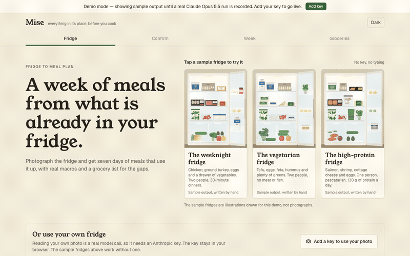
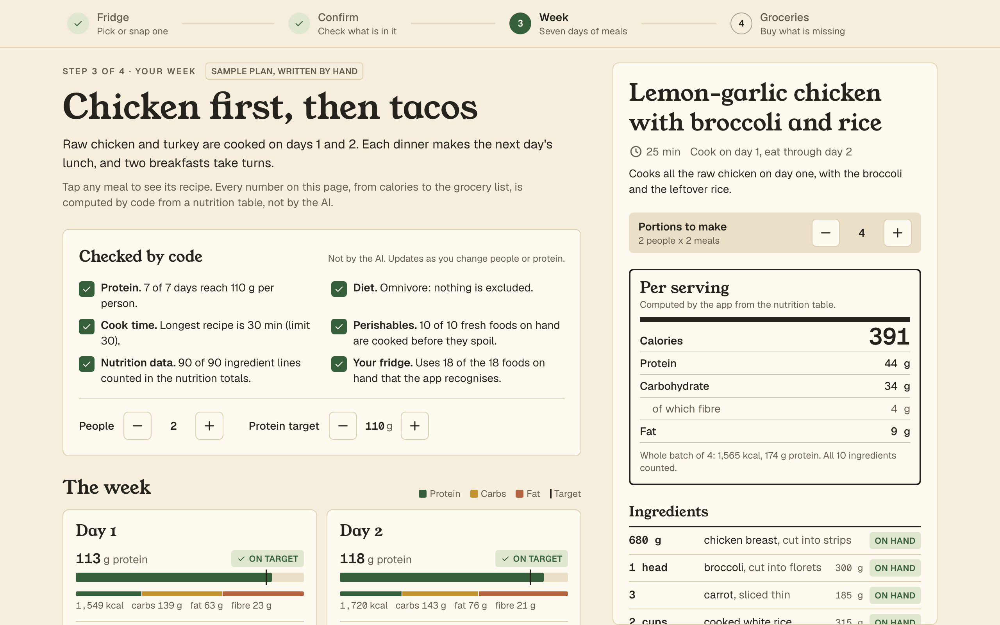
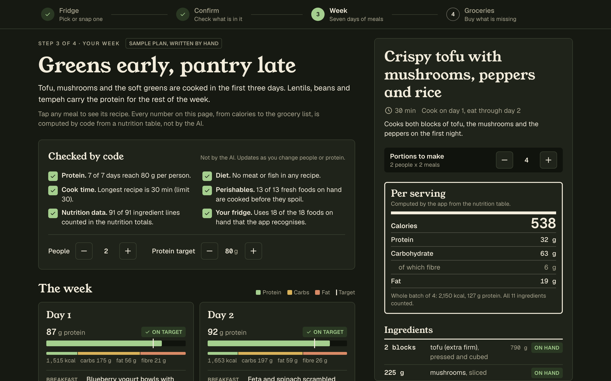
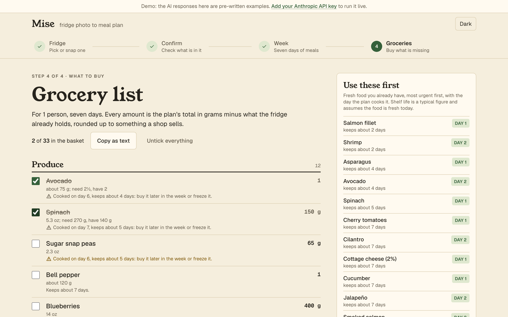
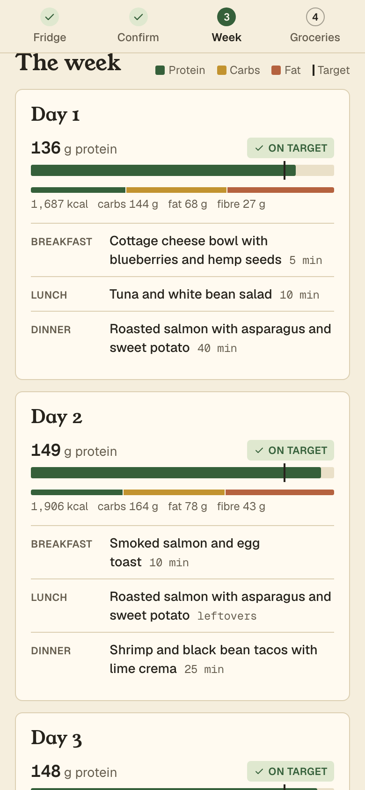
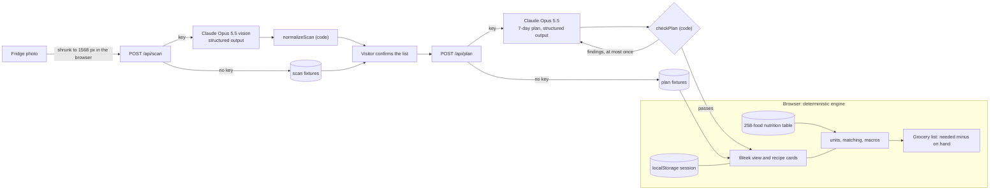

# Mise

> Photograph your fridge and get a week of meals that use what you already have, with the nutrition computed by code (not guessed by AI) and a grocery list for what is missing.

[](https://github.com/davezagin-max/mise/actions/workflows/ci.yml)
[](LICENSE)
[](#run-locally)



_The one-click demo, no key needed: pick a sample fridge, check what is in it, get seven days of meals with the nutrition worked out by code, then a grocery list for the gaps._

## What it does

- **Reads a photo of your fridge.** Claude Opus 5.5 lists each food it can see, roughly how much there is, and how sure it is. You fix anything it got wrong.
- **Plans seven days of meals** around your diet, cooking time, household size and protein goal, using up the food that spoils first.
- **Works out the nutrition in code, not in the AI.** Calories, protein, carbs and fat come from a nutrition table based on USDA data. The AI is never asked for a number.
- **Writes the grocery list:** what the week needs minus what is already in the fridge, grouped by supermarket aisle.

## Try it

The live demo is coming soon. Until then it runs on your own machine with no key and no sign-up (full steps in [Run locally](#run-locally)):

```bash
pnpm install
pnpm dev   # then open http://localhost:3180
```

The animation above is the whole demo. Tap one of the three sample fridges, then **Plan my week**. Open a recipe and change the portions, raise the protein target, and tick things off the grocery list: every number updates in the browser with no request. On a phone it installs to the home screen, and a plan you already have opens with no signal.

**About the demo data.** The AI responses in this commit (each fridge's ingredient list and meal plan) are hand-written examples, not real Claude runs, and the app says so on screen. `pnpm record` replaces them with real Claude Opus 5.5 runs, and the on-screen wording switches by itself. Add your own Anthropic API key in the app to run it live on a photo of your own fridge.



_The week view. "Checked by code" lists what the app verified itself (protein per day, diet, cooking time, food used before it spoils); the recipe card on the right scales its amounts and nutrition as you change the portions._

| Dark mode                                     | Grocery list                                                                | On a phone                                                         |
| --------------------------------------------- | --------------------------------------------------------------------------- | ------------------------------------------------------------------ |
|  |  |  |

## Why it's interesting

- **The model proposes; code computes every number.** The plan's output schema has no field for calories or macros, so there is nowhere for the model to put one. Each ingredient is matched to a food in a bundled nutrition table, converted to grams, and summed (`lib/nutrition/macros.ts`). Serving scaling, the protein check and the grocery list are the same pure functions running in the browser, which is why they respond instantly and work offline.
- **Conversions fail loudly instead of guessing.** "1 cup" only becomes grams if that food has a cup weight; "2 cloves" only if it has a clove weight (`lib/units.ts`). Anything else returns a typed reason, the ingredient is left out of the totals, and the UI names it. The grocery list does the same: when what you have and what you need cannot be compared in grams, the item is marked "look before you shop" rather than silently subtracted.
- **Code checks the plan and sends the facts back.** After the model drafts a week, `checkPlan` verifies the diet against the food data, the cook-time limit, each day's protein against the target, and whether anything perishable is first cooked after it would spoil. On a live run those findings go back to the model once, as a new turn in an append-only conversation, and a plan that still breaks a hard rule is rejected, not shown.

## Architecture



The request path is small: two routes, each a single `callClaude` through the shared helper. Most of the code is the engine in `lib/`, which has no I/O and is shared by the server (to check a plan before returning it) and the browser (to compute everything on screen).

## How it uses Claude Opus 5.5

| Feature                                                                   | Why                                                                                                                                                                                                                                                                          |
| ------------------------------------------------------------------------- | ---------------------------------------------------------------------------------------------------------------------------------------------------------------------------------------------------------------------------------------------------------------------------- |
| Vision with structured output (`/api/scan`, `medium` effort)              | One look at a cluttered shelf returns `{ name, quantity, unit, confidence }` per food. The confidence enum drives which rows the visitor is asked to double-check, and code then cleans names, canonicalises units and replaces impossible amounts with "1, low confidence". |
| Structured output with no nutrition fields (`/api/plan`, `medium` effort) | The schema is recipes and a 7-day grid. Numeric limits the API cannot express (7 days, 3 meals, cook time) are enforced after parsing. `medium` is enough because code catches what the model misses.                                                                        |
| Prompt caching                                                            | Both system prompts end with the full food catalog (names, and for the plan the units each food converts from) so the model returns names the matcher knows. That text is long and identical on every request, so it is cached.                                              |
| Append-only revision                                                      | When the checks fail, the assistant turn is sent back exactly as received (thinking blocks included) followed by a new user turn containing the computed facts: "Day 3 has 84 g of protein per person against a target of 110 g". No earlier turn is edited.                 |
| Untrusted input                                                           | The pantry list and preferences go in tagged blocks the system prompt declares to be data. For the photo, the prompt says writing visible in it is evidence of what a product is and never an instruction.                                                                   |
| Refusals and cancellation                                                 | A refusal is returned as a normal result and shown as one. The visitor's abort signal is passed to the SDK and checked between attempts, so leaving the page stops model calls on their key.                                                                                 |

The live path has not been run against the real API yet (no key was available while building). It is complete and covered by tests with a stand-in client; `pnpm record` is the first real run.

**Your key stays yours.** The app is bring-your-own-key. The key lives in your browser tab's memory (optionally `sessionStorage`), travels in an `x-anthropic-key` header to this app's own API route, and is used for that one request. The server never stores or logs it. Each live action shows its token count and cost. **Your photo** is shrunk and re-encoded in the browser (which also drops its location data), checked by the server, sent to Claude for that one request, and never written anywhere; the saved session holds the ingredient list, not the image.

## Run locally

```bash
pnpm install
pnpm dev
```

Open http://localhost:3180. It runs in demo mode until you add a key in the UI.

| Command                       | What it does                                                                                                              |
| ----------------------------- | ------------------------------------------------------------------------------------------------------------------------- |
| `pnpm record`                 | With `ANTHROPIC_API_KEY` set: records the three scans, rebuilds the plan presets from them, then records the three plans. |
| `pnpm samples`                | Redraws the sample fridges and app icons (SVG in code, exported to PNG).                                                  |
| `pnpm nutrition:refresh`      | With `USDA_API_KEY` set: compares every row of the nutrition table with FoodData Central (`--write` to update it).        |
| `pnpm build && pnpm ui:check` | Plays the main path headlessly at 360 px, 390 px and desktop.                                                             |

## Tests & quality

```bash
pnpm check   # lint, typecheck, unit tests, production build
```

214 tests. The ones worth reading:

- **Unit conversion** (`tests/core/units.test.ts`): mass, volume through each food's own density, count through piece weights, kitchen ratios, round trips, and every way a conversion is refused.
- **Macro math and matching** (`tests/core/match-macros.test.ts`): totals checked against figures worked out by hand, serving scaling, and look-alikes kept apart ("almond butter" is never "butter").
- **Grocery diff** (`tests/core/grocery.test.ts`): needed minus on hand across different units, rounding up to what a shop sells, "check" when amounts cannot be compared, perishables first.
- **Data integrity** (`tests/core/nutrition-data.test.ts`): every row's stated energy must agree with its own protein, carbohydrate and fat, which catches mistyped rows, and no name may point at two foods.
- **Plan checks and the live pipeline** (`tests/core/plan.test.ts`, `tests/pipeline/`): diet, time, protein and spoilage rules; the request shape the API requires; the revision loop; rejection after two failures; cancellation.
- **Fixtures** (`tests/fixtures.test.ts`): every demo fixture goes through the same schemas and checks as a live response. The tests read each fixture's own `placeholder` flag, so they still pass after real runs are recorded.
- **Smoke** (`tests/smoke.test.ts`): the main path through the real route handlers with no key.

`pnpm ui:check` covers what unit tests cannot: no sideways scroll on phones after interacting, the main button inside the first screen, a reload restoring the session mid-way, and the saved plan opening with the network off.

CI runs the same checks plus a gitleaks secret scan on every push.

## Tradeoffs, limitations, next steps

- **The nutrition table is hand-entered.** Its 258 rows follow USDA FoodData Central reference values (SR Legacy and Foundation Foods, public domain, https://fdc.nal.usda.gov/) but were typed in on 2026-10-11 without API access, so they are close approximations, not verified copies. The file says this in its own `meta.provenance`. `pnpm nutrition:refresh` checks every row against FDC once a key exists.
- **FoodData Central lookups are optional and untested live.** With `USDA_API_KEY` on the server, ingredients outside the table are looked up, cached on the server and in the browser, validated, and counted by weight. That path is tested with a stand-in `fetch`, not against the real API.
- **The sample fridges are illustrations**, drawn in code because no photograph of known licence was available. Vision on real, messy fridge photos is untested until fixtures are recorded.
- **Matching is strict by design**, so some real ingredients will not match and are left out of the totals (and shown as such). The fix is more aliases, not fuzzier matching.
- **Piece weights and shelf lives are typical values.** A "medium onion" is 110 g here; yours may not be. The perishables check assumes food is fresh today. It orders the week; it is not food-safety advice.
- **The diet check is as good as the tags.** It knows meat, fish, dairy, egg and honey. It does not know allergens, and it treats parmesan as vegetarian. Unknown ingredients are warned about by name, never passed silently.
- **In demo mode the plan is fixed per sample.** Editing the ingredient list changes the grocery list and the checks (that part is code) but not the recipes, which need a model call.
- **Only protein has a target.** Calories, carbohydrate and fat are computed and shown but not planned against.
- Rate limiting is in memory per server instance: enough to blunt abuse of a demo, not a global quota.

Next steps: record real runs and replace the illustrations with real photographs; refresh the table from FDC; stream the plan so the draft, check and revision are visible as they happen; let a visitor swap a single meal; a metric and US-customary toggle; a calorie target.

---

Built with Claude Code and Claude Opus 5.5.
